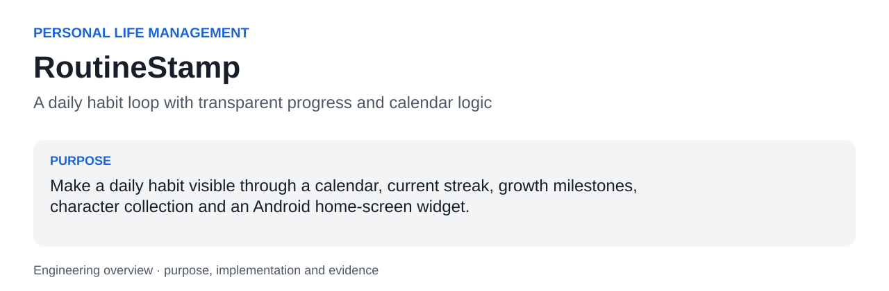
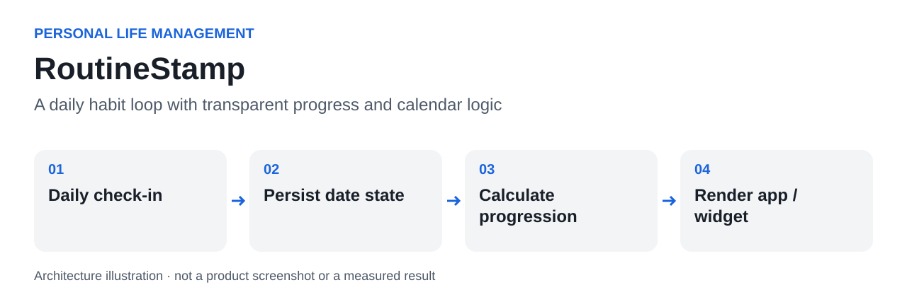

<a id="readme-top"></a>



# RoutineStamp

**A daily habit loop with transparent progress and calendar logic.**

Make a daily habit visible through a calendar, current streak, growth milestones, character collection and an Android home-screen widget.

| At a glance | |
|---|---|
| Context | Personal Life Management |
| Current evidence | Date and progression logic tested; Android packaging remains an archive migration task |
| Stack | Java, Android activities, App Widgets, SharedPreferences, bitmap-based share cards |
| Author | [hupositoc](https://github.com/hupositoc) |

[Case study](docs/case-study.md) · [Architecture](docs/architecture.md) · [Validation](docs/validation.md) · [Design rationale](docs/design-rationale.md)

## Table of Contents

- [About The Project](#about-the-project)
- [Getting Started](#getting-started)
- [Usage](#usage)
- [Roadmap](#roadmap)
- [Contributing](#contributing)
- [License](#license)
- [Contact](#contact)
- [Acknowledgments](#acknowledgments)

## About The Project

### Why I built it

A personal life-management app. Its purpose is to support a repeatable routine through feedback, not to claim scientifically measured habit improvement.

A generic checklist records completion but may provide little sense of continuity. A monthly routine also introduces edge cases: month length, leap years, a day that has not yet ended, gaps in a streak and progress thresholds near the end of February.

### What I implemented

Keep date/progression calculations in a Java logic class, persist checked dates and unlocked characters separately, and let the activity and widget render that state. Use growth milestones and a monthly collection as feedback rather than hiding the underlying calendar record.

### What this made possible

- Record and review daily completion in a monthly calendar.
- See streak and growth state calculated from explicit date rules.
- Expose progress through a widget and share a generated character card.

### What happened in practice

The source includes the calendar, progression, collection, share-card and widget paths. Existing tests verify the date and growth calculations in isolation. No usage study, retention improvement or behavioral outcome is claimed.

### Built With

Java, Android activities, App Widgets, SharedPreferences, bitmap-based share cards. Dependencies provide integration capabilities; the source links below identify the project-specific behavior.

### Engineering decisions

### Make date semantics explicit

A streak should not disappear in the morning merely because today has not yet been checked. Leap years and short months are part of the core logic.

### Separate state from presentation

The logic class can be exercised outside Android, while activities and widgets render a shared source of progress.

### Keep historical version evidence

The manifest identifies 6.7, while older build notes refer to 6.6. The public documentation explains this instead of silently rewriting the development history.

### Code to inspect

| Source entry point | Responsibility |
|---|---|
| [`currentStreak`](src/com/openai/routinequest/RoutineLogic.java#L54) | Treats an unchecked current day differently from an earlier missing day. |
| [`milestoneForLevel`](src/com/openai/routinequest/RoutineLogic.java#L29) | Adapts the final milestone to month length. |
| [`markToday`](src/com/openai/routinequest/AppData.java#L41) | Updates persisted check-in state. |
| [`updateWidget`](src/com/openai/routinequest/RoutineWidgetProvider.java#L18) | Renders the saved progress in a home-screen widget. |
| [`shareHeroCard`](src/com/openai/routinequest/CardShare.java#L26) | Builds a shareable character card. |

### AI-assisted engineering

I use AI development tools to turn concrete needs into working software. My engineering responsibilities include defining the problem, interpreting the operating constraints, reviewing behavior, investigating failures and checking results. AI assistance is a development method; it is not evidence that a feature works. File-by-file AI authorship or a specific assistant/model is not claimed without the corresponding development record.

## Getting Started

### Prerequisites

JDK for isolated logic tests; an Android toolchain and generated R resources for the complete app.

### Installation

```text
git clone https://github.com/hupositoc/routine-stamp.git
cd routine-stamp
```

Then follow the project-specific path:

```text
Review AndroidManifest.xml, src/ and res/.
Import or migrate the archived source into a maintained Android build.
Use the standalone Java tests to verify date/progression logic independently.
```

The commands describe the intended setup. See the validation record for which parts were actually executed in the current environment.

## Usage



**Text equivalent:** Daily check-in → Persist date state → Calculate progression → Render app / widget.

Start by defining the intended input and expected behavior. Save the configuration with the experiment or test session so that an output can be interpreted later. Review exceptions and raw evidence before treating a summary as a final conclusion.

The two existing standalone suites cover date counting, leap/month boundaries, progression milestones, next milestone and streak behavior. A tiny drawable-ID fixture resolves generated resource references only; it does not emulate Android.

### Boundaries and known limitations

- The archive uses src/res/AndroidManifest layout and is not yet a self-contained modern Gradle project.
- Android screen, widget and share-provider behavior were not tested on a device here.
- Character-art provenance and redistribution conditions require confirmation before broad reuse.
- The inherited package identifier does not indicate affiliation with the organization named in it.

Read the [case study](docs/case-study.md) for the purpose and enabled workflow, and [architecture](docs/architecture.md) for the source-level explanation. The [validation document](docs/validation.md) separates verified checks, author-reported use and pending integration work.

## Roadmap

- [ ] Migrate to a reproducible Gradle build without changing calendar semantics.
- [ ] Add widget and activity instrumentation tests.
- [ ] Document asset provenance and accessibility checks for text scale and touch targets.

These are planned tasks, not completed capabilities.

## Contributing

Use an issue to describe a reproducible problem, expected behavior, actual behavior and the environment. For a change, keep the scope focused and attach the relevant test or recording. Do not submit private customer data, identifying test captures, credentials or confidential certification documents.

## License

Existing file-level notices and third-party licenses remain in force. A repository-wide open-source license has not been selected for all archived material. Public visibility does not grant rights beyond those existing terms. Documentation structure attribution does not relicense the software.

## Contact

[hupositoc on GitHub](https://github.com/hupositoc) · [Project issues](https://github.com/hupositoc/routine-stamp/issues)

## Acknowledgments

The top-level section order follows [Best-README-Template](https://github.com/othneildrew/Best-README-Template), reviewed under its [Unlicense](https://github.com/othneildrew/Best-README-Template/blob/main/LICENSE.txt). All project narratives are written for this implementation. Visual guidance is attributed in [design rationale](docs/design-rationale.md). The broader 50-repository documentation review informs the reading order, source links and evidence presentation; it does not imply endorsement by those projects.


[Engineering decision record](docs/engineering-decisions.md) · [Review of 50 reference repositories](docs/reference-review-50.md)
