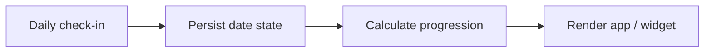

# Architecture and source walkthrough

## System boundary

Keep date/progression calculations in a Java logic class, persist checked dates and unlocked characters separately, and let the activity and widget render that state. Use growth milestones and a monthly collection as feedback rather than hiding the underlying calendar record.

This is a source-derived conceptual diagram, not a captured execution trace. The text equivalent is Daily check-in → Persist date state → Calculate progression → Render app / widget.

## Source responsibilities

| Source entry point | Responsibility |
|---|---|
| [`currentStreak`](../src/com/openai/routinequest/RoutineLogic.java#L54) | Treats an unchecked current day differently from an earlier missing day. |
| [`milestoneForLevel`](../src/com/openai/routinequest/RoutineLogic.java#L29) | Adapts the final milestone to month length. |
| [`markToday`](../src/com/openai/routinequest/AppData.java#L41) | Updates persisted check-in state. |
| [`updateWidget`](../src/com/openai/routinequest/RoutineWidgetProvider.java#L18) | Renders the saved progress in a home-screen widget. |
| [`shareHeroCard`](../src/com/openai/routinequest/CardShare.java#L26) | Builds a shareable character card. |

## Design decisions

### Make date semantics explicit

A streak should not disappear in the morning merely because today has not yet been checked. Leap years and short months are part of the core logic.

### Separate state from presentation

The logic class can be exercised outside Android, while activities and widgets render a shared source of progress.

### Keep historical version evidence

The manifest identifies 6.7, while older build notes refer to 6.6. The public documentation explains this instead of silently rewriting the development history.

## Input/output contract to preserve

The input configuration must be recoverable alongside the output. Defaults should be treated as this implementation’s starting values, not an external standard. An integration test must check the real host/runtime because an isolated function test cannot establish timing, UI, hardware or external-service behavior.

When modifying the code, identify which responsibility changes: input acquisition, interpretation, persistent state or output presentation. Keep the public behavior and its test evidence together. Avoid silently converting a missing input or failed integration into a successful result.

## Known boundaries

- The archive uses src/res/AndroidManifest layout and is not yet a self-contained modern Gradle project.
- Android screen, widget and share-provider behavior were not tested on a device here.
- Character-art provenance and redistribution conditions require confirmation before broad reuse.
- The inherited package identifier does not indicate affiliation with the organization named in it.
